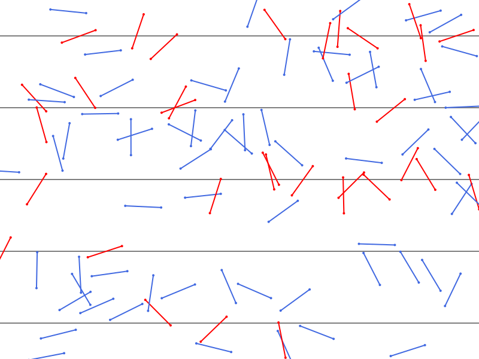

# Projects

\toc

## Buffon's Needle Problem (Multivariable Calculus Capstone)

~~~

    

        <!-- Clickable Cover Image -->
        

        <!-- Card Content -->
        

            <a href="https://pluto.land/n/xkryl1l3" target="_blank" style="text-decoration: none; color: inherit;">
                

                    Buffon's Needle Problem
                

            </a>
            

                Multivariable Calculus Capstone • Pluto.jl Notebook
            

            

                A geometric probability exploration using Monte Carlo methods to estimate π, complete with analytical calculus proofs and interactive Julia code.
            

        

        <!-- Action Buttons -->
        

            <a href="https://pluto.land/n/xkryl1l3" target="_blank" class="button-6" role="button">
                Open Notebook ↗
            </a>
        

    

~~~

